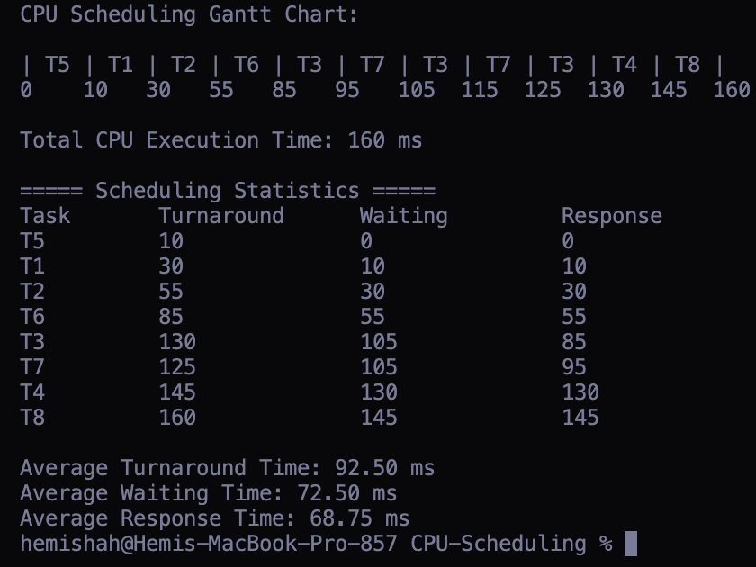

# CPU-Scheduling
Operating Systems: CPSC 380 - Programming Assignment 2

## Author
Name:  
Collaborator: 

## Design Overview
This program simulates multilevel queue CPU scheduling using four different scheduling algorithms. Each task is read from an input file and assigned to one of four queues based on its queue number.  

The four queues are:  
    - Queue 1 (Real-Time): Priority Scheduling, where tasks with higher priorities run first.  
    - Queue 2 (System): Shortest Job First (SJF), where tasks with shorter CPU bursts run first.  
    - Queue 3 (Interactive): Round Robin (RR), where tasks run for a maximum of 10 milliseconds before moving to the back of the queue if unfinished.  
    - Queue 4 (Batch): First Come First Served (FCFS), where tasks run in their original input order.  

The scheduler always checks the queues in order from 1 to 4 and selects tasks from the highest-priority nonempty queue. Each task stores its name, priority, CPU burst time, remaining time, and queue number.  

The CPU simulation uses a clock that increases by 1 millisecond for each execution step. As tasks run, their remaining burst times decrease until they finish. The program keeps track of execution times to generate a Gantt chart showing when each task starts and stops.  

The program calculates the turnaround time, waiting time, and response time for each task, along with the averages for all tasks.  

## How to Compile
    gcc CPUscheduler.c -o CPUscheduler

## How to Run
    ./CPUscheduler inputfile.txt

## Known Bugs or Problems

## Output Result

